# Offline-First Intelligent Tutoring Platform

## Project title

**Offline-First Intelligent Tutoring Platform: Enabling Resilient Academic Support**

**Repository:** [github.com/NzizaPacifique250/offline_tutor](https://github.com/NzizaPacifique250/offline_tutor)
**Student:** Nziza Aime Pacifique · **Target device:** ATMPC IT-801B Android tablet · **Pilot:** Rwanda REB Senior Six Advanced Mathematics

## Overview

This capstone project proposes an edge-computing tutoring platform that provides personalized, AI-driven academic support without requiring continuous internet connectivity. It is intended to support students in low-connectivity environments by running a language model locally on their device and storing essential curriculum resources and learning data offline.

The capstone will begin as a focused prototype for **one high-school grade and one subject**. After implementation and evaluation, the platform can be expanded to support additional grades and subjects through modular curriculum packages.

## Problem statement

Many AI tutoring systems depend on continuous internet access and cloud-hosted models. This limits their usefulness in communities with unreliable or expensive connectivity, creates recurring operational costs, and raises privacy concerns around student data.

This project investigates whether a resource-efficient language model running locally can provide useful, curriculum-aligned, and personalized academic assistance on modest hardware while remaining functional when the device is offline.

## Main objective

Design, implement, and evaluate an offline-first intelligent tutoring prototype that uses on-device language-model inference and locally stored curriculum resources to provide personalized academic support for students in one selected high-school grade and subject.

## Proposed research question

> To what extent can a resource-efficient, locally deployed language model provide reliable and personalized curriculum-grounded tutoring on devices operating with limited or no internet connectivity?

## Initial strategy

1. Build a prototype for one grade, one subject, selected topics, and one target device category.
2. Evaluate educational quality, offline reliability, performance, resource consumption, and usability.
3. Improve the prototype based on evaluation results.
4. Expand to other high-school grades and subjects using modular curriculum packages.

## Setting up the environment and the project

The repository has three parts: `tools/` and `bench/` (Python, run on the
laptop), `curriculum/` (the curriculum packages), and `app/` (the React
Native application for the tablet). Everything was developed on Linux; the
commands below assume a Linux or macOS shell.

### Prerequisites

| Component | Version used | Notes |
|---|---|---|
| Python | 3.10 or newer | for the grader, validator, extractor and model fetcher |
| Node.js | 22.11 or newer required by `app/package.json` | the project also runs on Node 20 (a known mismatch, tests pass) |
| JDK | 17 | `app/scripts/env.sh` expects it under `~/Android/jdk-17.0.20.1+1` |
| Android SDK | platform `android-37.0`, build-tools `37.0.0`, NDK `27.1.12297006`, CMake `3.22.1` | installed with `sdkmanager`; `env.sh` checks for them |
| adb | from the SDK platform-tools | the tablet must have USB debugging enabled |
| Target tablet | ATMPC IT-801B, Android 15, 4 GB RAM, arm64 | any arm64 Android device with about 2 GB free RAM should work; this one lacks the `dotprod`/`i8mm` CPU extensions, which is why speeds are what they are |
| Disk | about 6 GB free | model weights (935 MB), Android build output and `node_modules` |

### 1. Clone and install

```bash
git clone https://github.com/NzizaPacifique250/offline_tutor.git
cd offline_tutor

# Python tools
python3 -m venv .venv
.venv/bin/pip install -r tools/requirements.txt

# Application
cd app && npm install && cd ..
```

### 2. Check that the tools work

```bash
./.venv/bin/python tools/grade.py --self-test
for u in u1 u4 u5 u9; do ./.venv/bin/python tools/validate_package.py curriculum/rw_s6_mathematics/packages/$u; done
cd app && scripts/sync_content.sh && scripts/sync_katex_assets.sh   # generated inputs the tests need
npm test && npm run typecheck && npm run lint && cd ..
```

The grader and validator should end with `[ok]` lines, and the app should
pass 269 tests in 12 suites with no type or lint errors.

### 3. Get the model onto the tablet

The model weights are not in the repository. `tools/fetch_models.py`
downloads the candidates listed in `bench/models.json` from Hugging Face
with resumable transfers; the provisional model is Qwen2.5-Math-1.5B-Instruct
Q4_K_M (935 MB).

```bash
./.venv/bin/python tools/fetch_models.py --id qwen25-math-1.5b
bench/scripts/02_push_to_device.sh          # stages models and probes on the tablet over adb
```

### 4. Build, install and run the application

```bash
. app/scripts/env.sh                        # toolchain paths and the memory-capped native build
app/scripts/run_debug.sh                    # validates and bundles the curriculum, builds the APK,
                                            # installs it, starts Metro and launches the app
app/scripts/stage_model.sh                  # copies the model into the app's private storage
```

The first native build takes about 15 minutes on an 8 GB laptop because
the build is deliberately capped at three compilers; later builds take
under a minute. The APK bundles its JavaScript, so once installed the app
runs with the cable removed and the network off; with Metro running it
reloads edits live instead.

To install the signed pilot build on a tablet without any developer tools
(the APK from the Files app, then the model from Teacher tools with its
checksum checked), follow [docs/INSTALLATION_GUIDE.md](docs/INSTALLATION_GUIDE.md).

### 5. Reproduce the benchmark (optional)

`bench/README.md` describes the device profile, the llama.cpp cross-build,
the throughput run and the 28-probe sweep.

### 6. Curriculum source books (optional)

The REB Senior Six Advanced Mathematics Student's Book and Teacher's Guide
are not included in this repository because their copyright notices reserve
all rights. They are only needed to re-run `tools/extract_corpus.py`.
Download them from the REB e-learning portal and place them in
`curriculum/rw_s6_mathematics/sources/` as
`S6_Advanced_Math_StudentBook.pdf` and `S6_Advanced_Math_TeacherGuide.pdf`.

## Designs

This is a software project on an off-the-shelf tablet, so there is no
circuit diagram; the hardware is described in
[bench/results/device_profile.md](bench/results/device_profile.md). The
interface was refined on the device rather than in Figma; the screenshots
below are the interface as built. The data model the app implements is in
`app/src/content/types.ts` and `app/src/learner/store.ts`.

### Application interfaces (screenshots from the tablet, airplane mode on)

| Screen | Screenshot |
|---|---|
| Topics, with progress and the recommended next exercise | 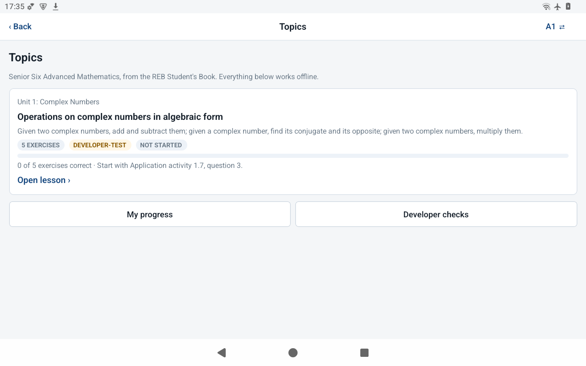 |
| Lesson rendered offline with KaTeX | 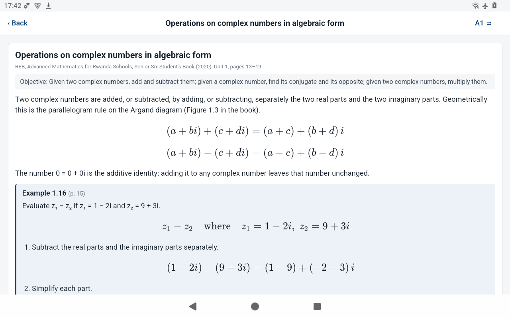 |
| Practice: an answer checked on the device, hints before the solution | 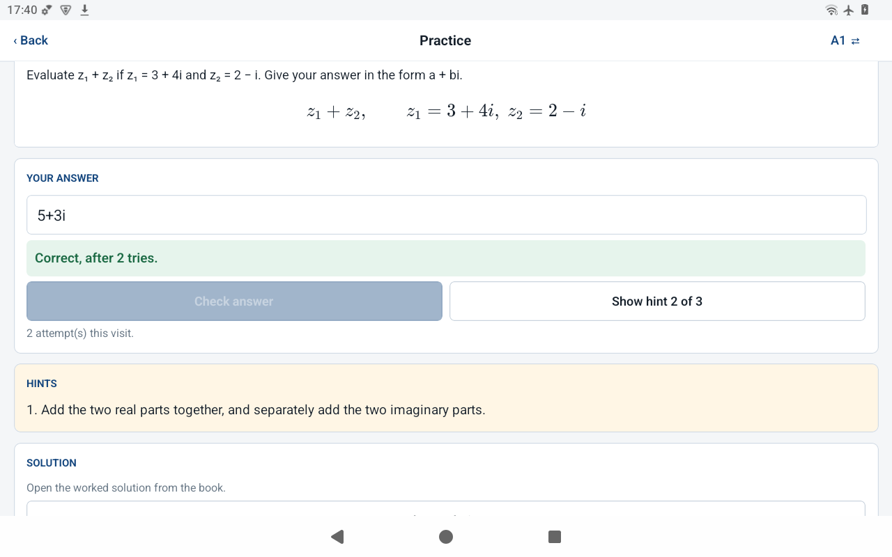 |
| Worked solution from the book | 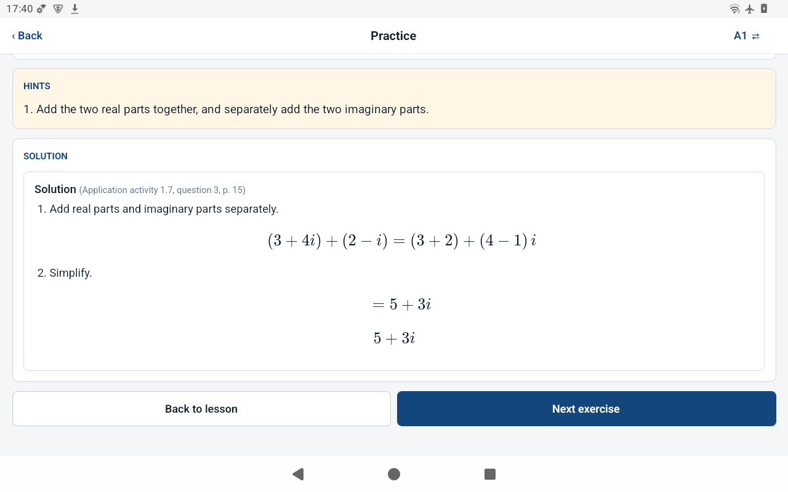 |
| Progress computed from saved attempts | 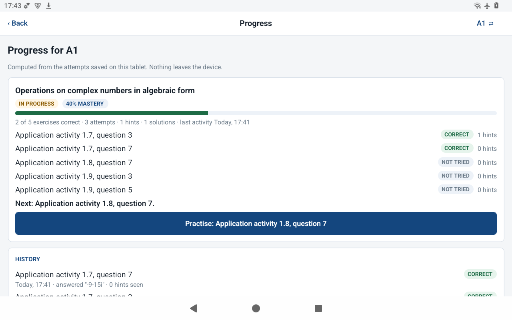 |
| Out-of-scope question declined without the model | 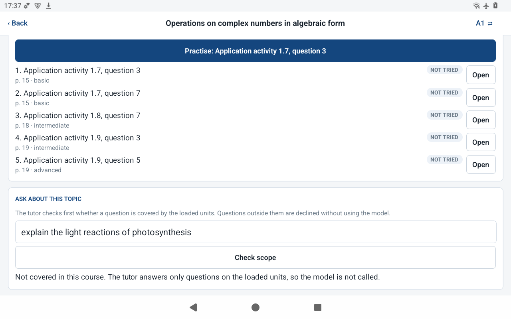 |
| Tutor answering one step at a time | 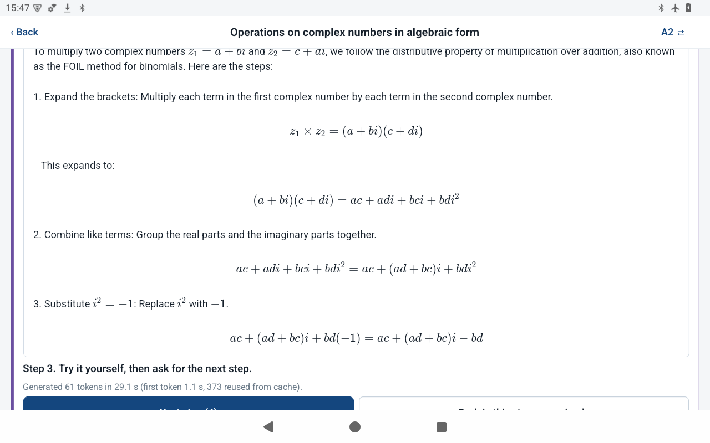 |
| A simpler explanation of a step | 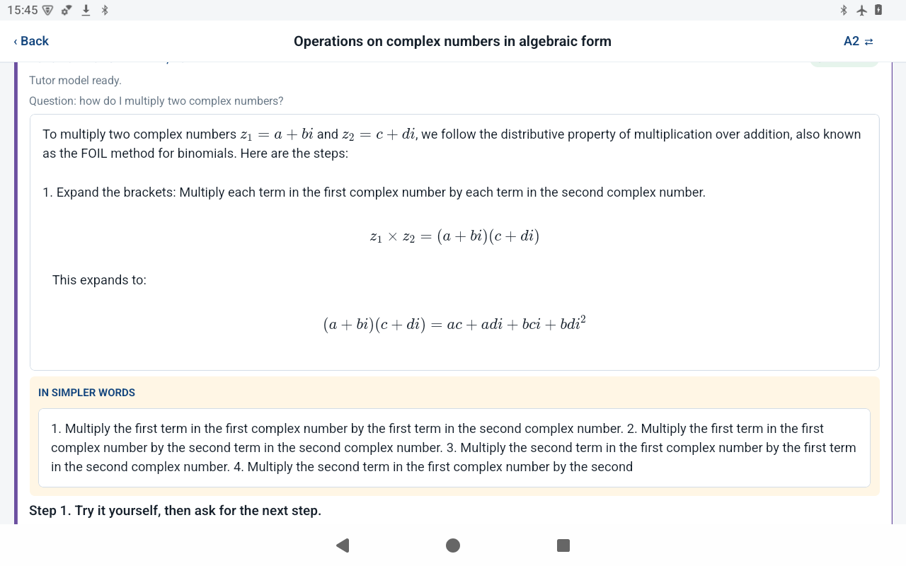 |
| Stored hint served before any generation | 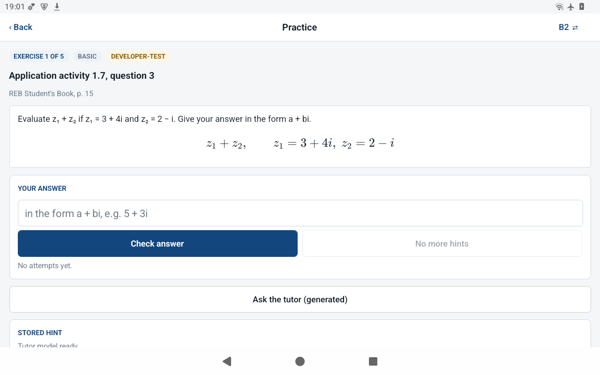 |
| Model missing: stored content still works | 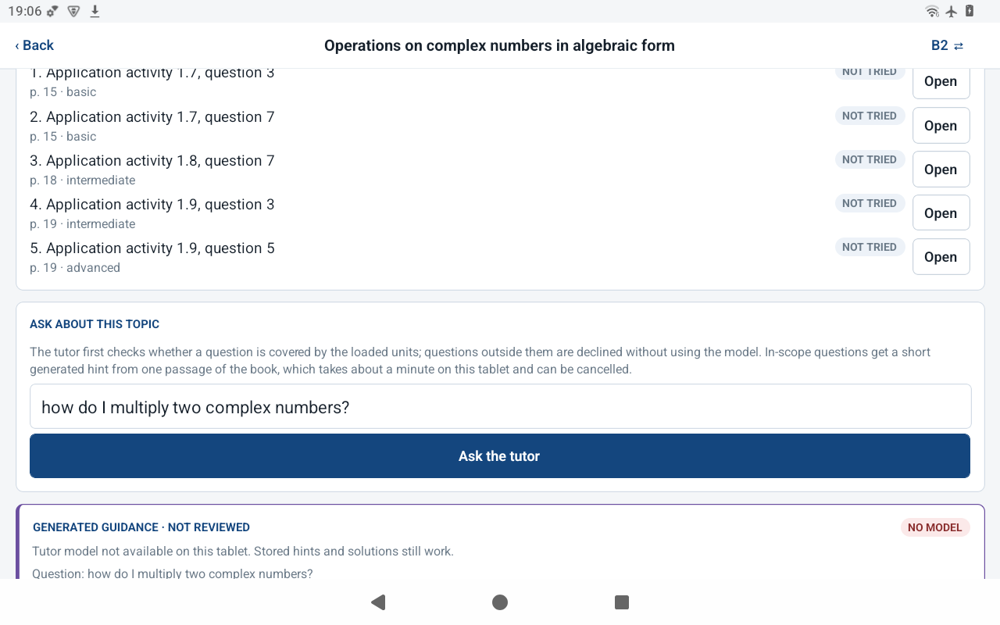 |
| App launched with no laptop attached | 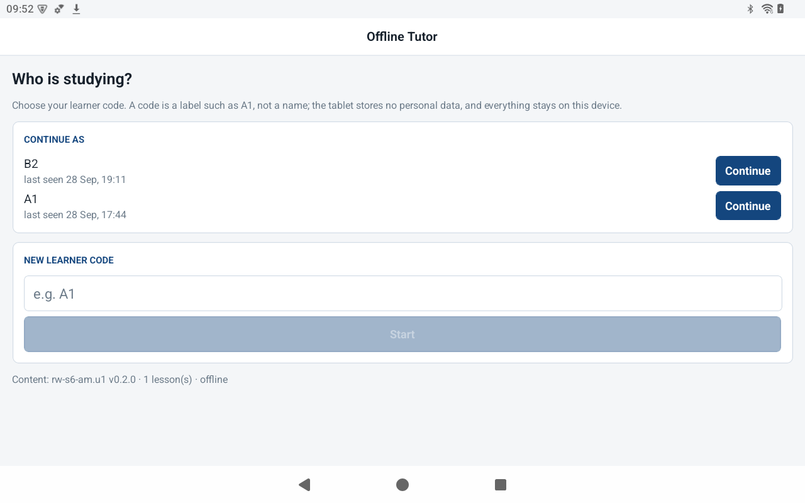 |

## Deployment plan

The platform deploys to tablets that are prepared once and then used with
no network. The plan, from the state today to the school pilot:

1. **Test build (done).** A debug-signed APK with the JavaScript bundled
   runs on the tablet with no laptop, no tunnel and no Metro. The model is
   copied into the app's private storage with `app/scripts/stage_model.sh`,
   the curriculum package is bundled in the APK and imported into SQLite on
   first launch, and KaTeX is packaged as an asset. Nothing is fetched at
   run time.
2. **Release build and model installation (done, v1.0.0).** A signed
   release APK installed from the tablet's Files app, with no internet
   permission; the 986 MB model is copied onto the tablet and installed
   from Teacher tools, which checks its size and SHA-256
   ([docs/RELEASE_V1.md](docs/RELEASE_V1.md)). The weights are Apache-2.0
   and the app shows the notice.
3. **Diagnostics and result export (done).** Teacher tools export the
   learner records as CSV with a manifest of the build, commit, content
   versions and model checksum; tutor timings are in the records.
4. **Installation guide and tablet test script (done).**
   [docs/INSTALLATION_GUIDE.md](docs/INSTALLATION_GUIDE.md) and
   [docs/TABLET_TEST_CHECKLIST.md](docs/TABLET_TEST_CHECKLIST.md); the
   readiness checks passed on 19 October
   ([docs/evidence/v1-readiness-2026-10-19/](docs/evidence/v1-readiness-2026-10-19/)).
5. **School pilot at Agahozo Shalom Youth Village.** After teacher review
   of the content and the institutional approvals: tablets prepared
   offline, learner codes rather than names, data kept on the device,
   results exported by the researcher.
6. **Updates.** Curriculum packages are versioned; a new version is
   re-imported on the next launch. Application updates are a new APK.
   Synchronization stays optional and never on the tutoring path.
7. **After the capstone.** More units and grades through the package
   format, one subject at a time.

## Current status

**v1.2.2, the pilot build, is ready for structured testing: four units, an on-device tutor, and teacher tools with class progress, collected from every student tablet over Bluetooth without a network, and research export; installed without developer tools.** See [docs/RELEASE_V1.md](docs/RELEASE_V1.md). Testing with students waits for teacher review of the content and the institutional approvals.

The pilot scope is fixed: Rwanda REB curriculum, Senior Six Advanced
Mathematics, four pilot units, an ATMPC IT-801B Android tablet, React Native
with `llama.rn`.

What exists now:

- `bench/`: a benchmark kit that cross-compiles llama.cpp for the tablet's CPU,
  pushes models over adb, measures throughput and answer quality, and grades answers
  deterministically. See [bench/README.md](bench/README.md).
- `curriculum/rw_s6_mathematics/packages/`: four curriculum packages, one lesson
  each for Complex Numbers, Integration, Differential Equations and Random
  Variables, with worked examples and exercises taken from the REB Student's
  Book, checked by `tools/validate_package.py`.
- `tools/`: model fetcher, benchmark driver, symbolic grader (audited and
  corrected on 2026-09-21), package validator and corpus extractor.
- `app/`: the React Native application. A learner chooses a code, opens a
  lesson in any of the four units rendered with KaTeX from local assets, practises the book's
  exercises with answers checked on the device against the proven keys, reveals
  hints in order before the solution, and reviews progress computed from saved
  attempts; all of it in airplane mode, surviving a restart, with learner codes
  kept apart. A question box asks the local model, but only after the router
  has matched a loaded topic, from one passage of the book, one request at a
  time, cancellable, paced one step at a time with "Next step" and "Explain
  this step more simply", with the text labelled as generated and never used
  for marking; on an exercise the stored hints come first and the model's
  text is masked wherever it states the answer. Behind a PIN, teacher tools
  install the model, show class progress (including progress files received
  from other tablets over Bluetooth), and export the records for research.
- `bench/results/THROUGHPUT_FINDINGS.md`: measured tokens per second on the tablet's
  CPU and GPU and what that means for response time.

Two findings shape everything that follows:

- **Accuracy is not the constraint.** After the grading audit, Qwen2.5-Math-1.5B
  answered 23 of 24 S6 mathematics probes correctly. It is the provisional model.
- **Speed is.** The tablet generates at 2.2–2.7 tokens per second, which rules out
  a live retrieve-then-generate design. The replacement is reviewed content served
  instantly plus short bounded generation.

The application bridge is proven on the device: the correct `armv8-a` native
library loads, the model answers in-app at benchmark speed, records persist
across restarts, and equations render offline.

## Documentation

- [Release notes and the readiness run](docs/RELEASE_V1.md)
- [Installation guide](docs/INSTALLATION_GUIDE.md) and [tablet test checklist](docs/TABLET_TEST_CHECKLIST.md)
- [Readiness run evidence: exported records, app log, temperature](docs/evidence/v1-readiness-2026-10-19/)
- [System architecture](docs/ARCHITECTURE.md)
- [Feature map: which directory owns what, and its tests](docs/feature-map.md)
- [Feasibility findings: model selection and the grading audit](docs/FEASIBILITY_FINDINGS.md)
- [Benchmark kit](bench/README.md) and [throughput findings](bench/results/THROUGHPUT_FINDINGS.md)
