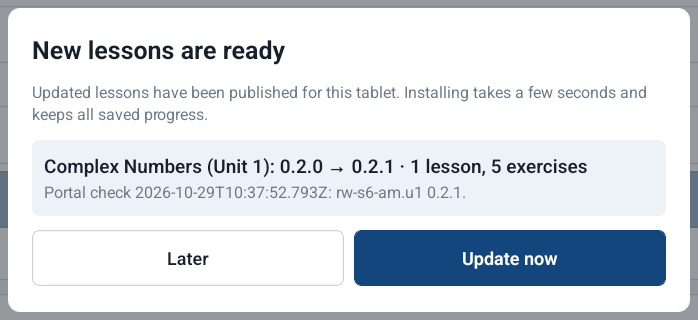
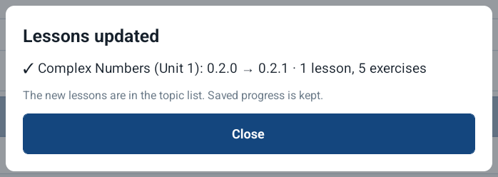
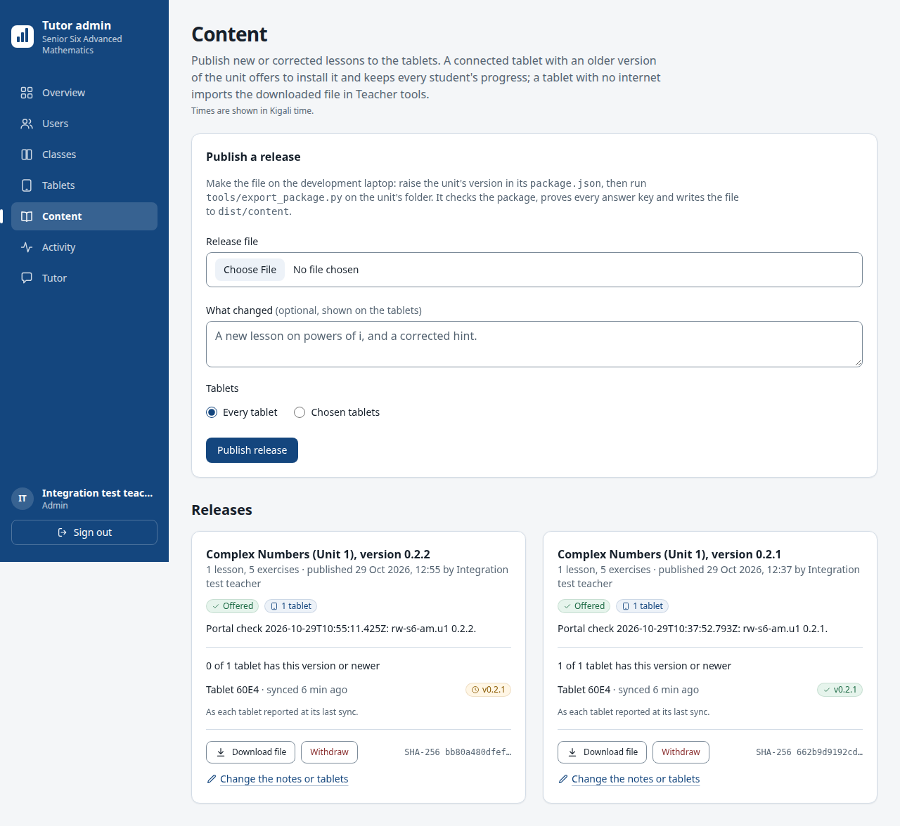
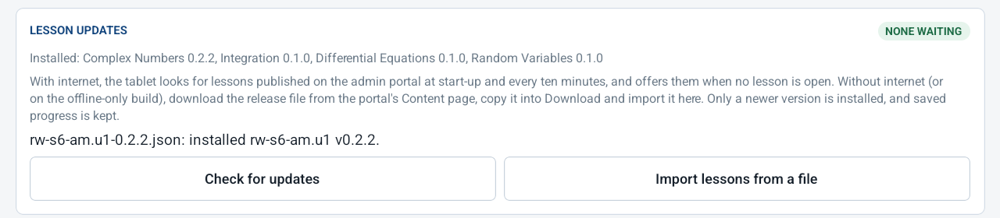

# Lesson updates on the tablet (29 October 2026)

Release 1.4.0 (build 8, commit `de0502a`), connected build, on the ATMPC
IT-801B ("Tablet 60E4"), with the admin portal built from the same commit
and the live Supabase project after migration 0006. Two test releases of
Unit 1 were made from a copy of its package with only the version raised
(0.2.1 and 0.2.2, the same lessons as 0.2.0), exported with
`tools/export_package.py`, published on the portal's Content page for this
tablet only, and withdrawn after the test.

| Step | What happened | Result |
|---|---|---|
| Install 1.4.0 over 1.3.0 | `adb install -r`; About this build reads "Offline Tutor 1.4.0 (build 8, release, commit de0502a)" | Records, accounts and the model kept |
| Publish 0.2.1 | Published at 12:37 for Tablet 60E4, listed with the database's checksum `662b9d91…`, which is the file's SHA-256 | Pass |
| The pop-up (connected) | With Wi-Fi on, the app found the release at start-up, 26 s after launch, and showed **New lessons are ready** on the sign-in screen |  |
| Update now | Downloaded, checked and installed about 4 s after the tap; the content line on the first screen and About this build then read `rw-s6-am.u1 v0.2.1` |  |
| The portal after the tablet synced | 0.2.1: "1 of 1 tablet has this version or newer" |  |
| Check for updates in airplane mode | "Could not check for updates: No internet connection." | Pass |
| Publish 0.2.2, then import the file offline | The file downloaded from the portal, byte for byte the one published, was copied into Download; **Import lessons from a file** reported "installed rw-s6-am.u1 v0.2.2", and the checksum the tablet logged (`bb80a480dfef…`) is the one the portal shows |  |
| The same file again | "rw-s6-am.u1 is already at 0.2.2; nothing changed." | Pass |
| Restart, offline | `[boot] content rw-s6-am.u1 v0.2.2: kept-newer`: the bundled 0.2.0 does not replace the update | Pass |
| The learners' records | Class progress still lists the tablet's 15 learners and 79 checked answers | Pass |

The app's log (`adb logcat`, tag ReactNativeJS), connected:

```
12:51:39 [updates] available: rw-s6-am.u1 v0.2.1
12:52:03 [updates] rw-s6-am.u1 v0.2.1: installed
12:52:03 [updates] content now Content: rw-s6-am.u1 v0.2.1, rw-s6-am.u4 v0.1.0, rw-s6-am.u5 v0.1.0, rw-s6-am.u9 v0.1.0 · 4 lesson(s) · offline
```

and in airplane mode:

```
12:54:42 [updates] check: No internet connection.
12:55:57 [updates] file rw-s6-am.u1-0.2.2.json (sha256 bb80a480dfef…): installed
12:56:25 [updates] file rw-s6-am.u1-0.2.2.json (sha256 bb80a480dfef…): not-newer
12:56:45 [boot] content rw-s6-am.u1 v0.2.2: kept-newer (1 lesson, 2 examples, 5 exercises)
```

Notes:

- The pop-up was seen at start-up. The ten-minute check while the app stays
  open was not observed on the tablet: the first wait for it ran against
  the older development app, which the driver opens unless
  `APP_ID=rw.offlinetutor.pilot` is set.
- Looking for updates downloads releases and sends nothing about learners.
  Sync is separate: while Wi-Fi was on it ran, as it does whenever the
  tablet is online, for the accounts on the tablet that had switched it on.
- The tablet keeps Unit 1 at 0.2.2, the same lessons as 0.2.0. The next
  Unit 1 release must be newer than 0.2.2, which the database requires in
  any case.
- The pop-up screenshots are cropped to the dialog: the sign-in screen
  behind it lists the accounts on the tablet.
